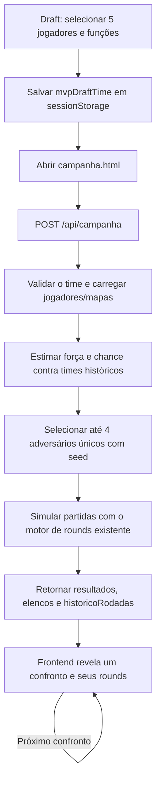

# Campanha e Simulação

Guia técnico da implementação de Campanha do MVP - Valorant Draft Simulator. A implementação usa Node.js/Express no backend, MongoDB/Mongoose para os dados históricos e HTML, CSS e JavaScript vanilla no frontend.

## Visão geral



A API é a fonte dos resultados. A interface anima dados já simulados; ela não calcula placares nem sorteia resultados.

## Regras da campanha

- O título exige `4` vitórias, definido por `VITORIAS_PARA_TITULO` em `logic/campaign/campaign.js`.
- A primeira derrota elimina o time imediatamente.
- O seletor e o endpoint usam a mesma constante. São escolhidos no máximo quatro adversários distintos, um por confronto potencial.
- Como uma derrota encerra a campanha, uma campanha real pode ter de um a quatro jogos.
- `estado` pode ser `em andamento`, `eliminado` ou `campeão`.

## Fluxo do Draft

Quando o roster tem cinco jogadores, `public/assets/js/draft.js` constrói o objeto do time com `nome`, `jogadores`, `funcao` e `overall`. O objeto é salvo em `sessionStorage` sob a chave `mvpDraftTime`, e o navegador segue para `public/campanha.html`.

A tela da campanha lê essa chave e envia o time para `POST /api/campanha`. Elencos personalizados continuam sem temporada histórica; os detalhes do jogador vêm do Draft. O adversário é ligado aos registros históricos pelo `time_id` e `ano` do banco.

## API da campanha

### Requisição

`POST /api/campanha`

```json
{
  "timeJogador": {
    "nome": "Meu Time",
    "jogadores": [
      { "nome": "Jogador 1", "funcao": "Duelista", "overall": 90 }
    ]
  },
  "seed": "campanha-de-teste"
}
```

O exemplo mostra um jogador para resumir o formato; a API exige exatamente cinco jogadores e valida que cada um tenha nome, função e overall numérico finito. `seed` é opcional. Se não for enviada, o backend cria uma seed para a nova campanha.

### Resposta

Os campos principais são:

| Campo | Descrição |
| --- | --- |
| `seed` | Seed usada para gerar a campanha. Pode ser reutilizada na requisição para reproduzir o resultado. |
| `versaoCampanha` | Versão das regras e seleção; atualmente `campanha-seed-v3`. |
| `vitoriasNecessarias` | Meta de vitórias para o título; atualmente `4`. |
| `timeJogadorDetalhes` | Nome e roster de cinco jogadores do Draft. |
| `estado`, `vitorias`, `derrotas` | Estado e totais finais da campanha retornada. |
| `partidas` | Partidas geradas até o título, a eliminação ou o limite de quatro confrontos. |

Cada item de `partidas` inclui número do confronto, nome e ano do adversário, `time_id`, os cinco jogadores históricos, mapa, lado favorecido, lados iniciais, placar, vencedor, estado e contadores após aquele jogo, mais `historicoRodadas`. `probabilidadeEstimadaVitoria` é uma estimativa usada na seleção, não uma promessa de resultado.

Cada entrada de `historicoRodadas` contém o número do round, vencedor, placar atualizado e lados usados naquele round.

## Seleção e progressão da dificuldade

A lógica está em `logic/campaign/campaignLogic.js` e reutiliza as funções de força e o simulador de `logic/matches/matchesLogic.js`.

1. Os times candidatos são agrupados por `time_id`, ordenados por ID, filtrados para conter exatamente cinco jogadores e excluídos se estiverem em `timesExcluidos`.
2. `montarTimeHistorico` converte a primeira função de `funcoes` do Mongo para o formato `funcao` usado pelo motor e preserva nome, overall, time e ano. Assim, os multiplicadores de função usados na partida também entram no cálculo da força histórica.
3. Ataque, defesa e força geral são os mesmos cálculos do motor real. A força geral é a média de ataque e defesa; não se seleciona adversário apenas pela média do overall.
4. A qualidade relativa do time do jogador é calculada como sua posição (percentil/rank com tratamento de empates) entre as forças dos times históricos elegíveis.
5. Para cada candidato, `estimarProbabilidadeVitoria` simula partidas com o `Match` e `simularPartida` existentes: para cada mapa disponível, testa ataque e defesa como lado inicial, com quatro amostras por combinação. Com 13 mapas, são 104 simulações estimativas por adversário.
6. A meta estimada é interpolada pela posição do elenco do jogador entre as referências de elenco fraco e forte:

| Confronto | Referência para elenco fraco | Referência para elenco forte |
| --- | ---: | ---: |
| 1 | 45% | 78% |
| 2 | 45% | 78% |
| 3 | 37% | 65% |
| 4 | 37% | 65% |

7. O peso de cada time cresce quanto mais perto sua chance estimada estiver da meta da fase. A distribuição usa tolerância de `0.06` e um piso de peso de `0.005`; portanto, candidatos distantes ficam raros, mas não são removidos de forma absoluta.
8. Cada escolha é feita por sorteio ponderado sem reposição. Não há alteração de overall nem vitória/derrota forçada.

As referências são alvos de amostragem, não limites nem garantias matemáticas. A chance por candidato usa amostragem finita e valores históricos; o resultado real continua vindo do sorteio de rounds do motor.

## Simulação de partida

A implementação de partida permanece específica para Valorant. As regras principais ficam em `logic/matches/matchesLogic.js`:

| Função | Multiplicador de ataque | Multiplicador de defesa |
| --- | ---: | ---: |
| Duelista | 1.40 | 1.00 |
| Iniciador | 1.25 | 1.15 |
| Controlador | 1.15 | 1.25 |
| Sentinela | 1.00 | 1.40 |

Para cada jogador, o overall é multiplicado pelo fator de sua função; a soma do time é dividida por cinco para obter ataque e defesa. A força geral é `(ataque + defesa) / 2`.

Em cada round, a probabilidade base do Time A é logística: `1 / (1 + exp(-diferenca / 12))`. A diferença usa ataque do time que ataca contra defesa do time que defende. O lado favorecido pelo mapa recebe um bônus de cinco por cento da probabilidade restante. Os lados trocam após o round 12 e, em overtime, a cada dois rounds a partir do 24.

O jogo termina quando um time alcança pelo menos 13 rounds e vence por dois ou mais. `simularPartida(partida, rng)` aceita uma função RNG; sem argumento, mantém `Math.random` para chamadas existentes.

## Seed e reprodutibilidade

`criarPRNG(seed)` transforma a string da seed em uma função pseudoaleatória. Na rota da campanha, uma única instância controla a ordem de adversários, os mapas, o lado inicial e os resultados de rounds. As estimativas de seleção também usam seeds derivadas da seed principal e das identidades do candidato, mapa, lado e amostra.

Com a mesma seed, os mesmos rosters/mapas, a mesma ordem dos dados e a mesma versão de regras, a resposta da API é reproduzível. A seed é incluída na resposta e deve ser enviada explicitamente para repetir a chamada. Atualmente, `public/assets/js/campanha.js` envia somente `timeJogador`; portanto, recarregar a tela inicia uma nova campanha com seed gerada pelo backend. A versão da regra está em `versaoCampanha` para distinguir campanhas feitas com comportamentos diferentes.

## Revelação progressiva no frontend

`public/assets/js/campanha.js` mantém o payload recebido em memória, mas apresenta somente o confronto atual. O roster, o ano, o mapa e os lados aparecem para o jogo atual; depois, cada round é revelado com placar e vencedor. Ao final, o jogador vê o resultado e pode avançar pelo botão `Próximo confronto`. O próximo adversário só é renderizado após essa ação.

A interface atualiza a barra de progresso a partir dos contadores da partida revelada e do limite `vitoriasNecessarias`. Estados finais mostram campeão ou eliminação e ocultam o botão de avanço.

O visual de `public/campanha.html` e `public/assets/css/campanha.css` reutiliza os estilos globais de `public/assets/css/style.css`: fonte Ubuntu, fundo escuro ameixa, vermelho de ataque, verde-água de defesa, navbar/container globais e cards responsivos. A página usa CSS próprio para organizar score, rosters e feed; não adiciona Tailwind ou outro framework.

## Arquivos relacionados

| Arquivo | Responsabilidade |
| --- | --- |
| `logic/campaign/campaign.js` | Estado da campanha, eliminação e limite de quatro vitórias. |
| `logic/campaign/campaignLogic.js` | Seed, força role-aware, estimação de chance e seleção de adversários/mapas. |
| `logic/matches/matches.js` | Modelo de partida e cálculo de ataque, defesa e força dos times. |
| `logic/matches/matchesLogic.js` | Probabilidade e simulação dos rounds com RNG injetável. |
| `server.js` | Validação do time, acesso ao MongoDB, orquestração da campanha e contrato HTTP. |
| `public/assets/js/draft.js` | Finalização do Draft, persistência de roster em sessionStorage e navegação. |
| `public/campanha.html` | Estrutura da tela de campanha. |
| `public/assets/js/campanha.js` | Consumo da API, renderização e revelação progressiva. |
| `public/assets/css/campanha.css` | Layout e componentes específicos alinhados ao tema global. |
| `logic/campaign/campaignLogicTest.js` | Testes isolados das regras de campanha. |
| `logic/campaign/campaignBalanceTest.js` | Teste sem banco para roster role-aware, seed e seleção sem repetição. |
| `logic/campaign/campaignTest.js` | Teste integrado com os dados servidos pela API. |

## Testes

A suíte automatizada configurada em `package.json` é executada com:

```bash
npm test
```

Ela roda os testes de rounds, partidas, regras isoladas da campanha e seleção role-aware determinística. O teste integrado com Mongo/API pode ser executado à parte:

```bash
node logic/campaign/campaignTest.js
```

Esse teste precisa do servidor disponível em `http://localhost:3000` e dos dados históricos/mapas acessíveis no MongoDB. O teste não faz parte de `npm test` porque depende desse ambiente externo.

## Considerações para manutenção

- Se o limite de vitórias mudar, atualizar `VITORIAS_PARA_TITULO` e conferir as metas por fase, os testes e o texto dinâmico da UI. A seleção padrão e a rota já leem a constante compartilhada.
- Se forem alteradas as regras de força, funções, mapa ou rounds, as estimativas de seleção mudam junto porque reutilizam o motor real. Evitar duplicar essas fórmulas em `campaignLogic.js`.
- Se mudar o formato de `funcoes` ou a identidade histórica, atualizar `montarTimeHistorico` e os testes de roster.
- Se o frontend passar a oferecer replay de campanhas, enviar e armazenar a seed e a versão das regras junto com o Draft; atualmente cada carregamento gera uma campanha nova.
- A rota retorna os dados de todos os confrontos já simulados, embora a interface os revele gradualmente. A progressão é uma regra de apresentação, não uma fronteira de segurança entre cliente e backend.
