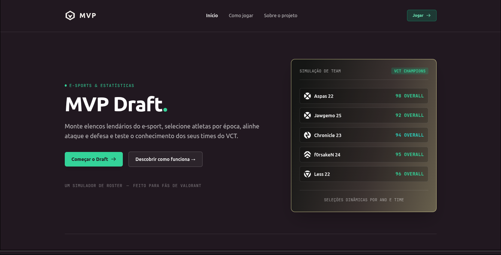
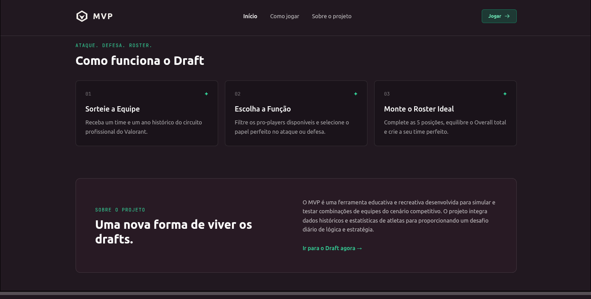
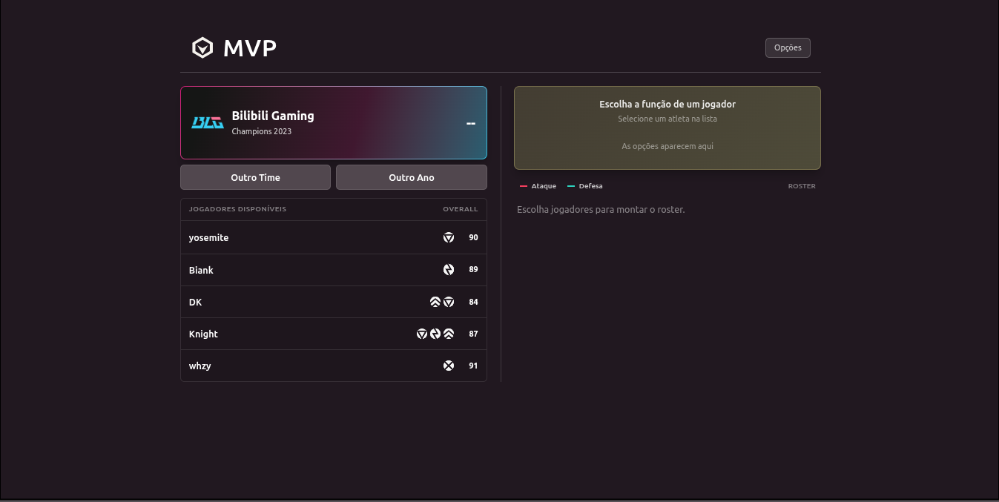
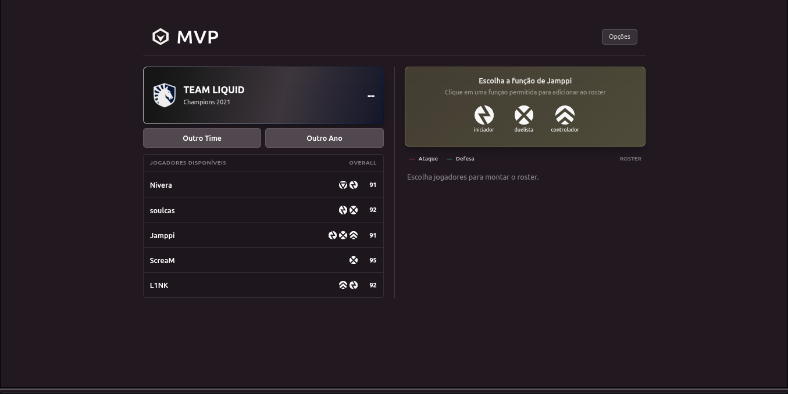
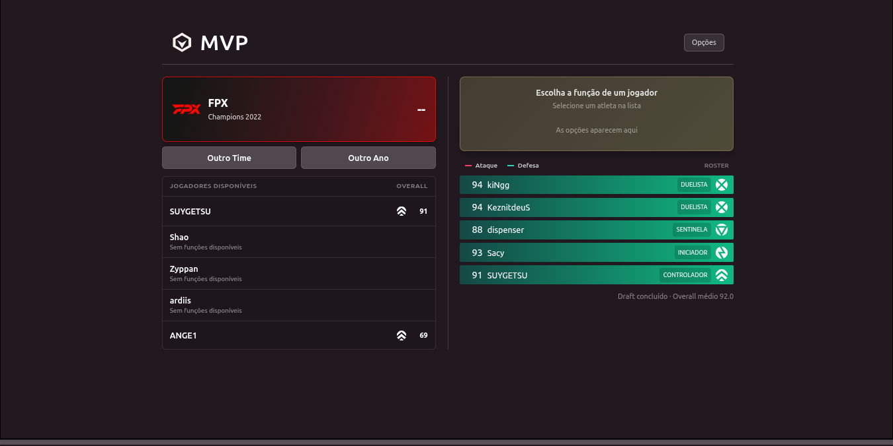

# MVP - Valorant Draft Simulator


<p align="center">
  
</p>

<h1 align="center">MVP - Valorant Draft Simulator</h1>

<p align="center">
  Simulador interativo de draft do e-sport Valorant desenvolvido com HTML5, Tailwind CSS, Vanilla JavaScript e Node.js.
</p>

---

## 📖 Sobre o Projeto

O **MVP - Valorant Draft Simulator** é uma aplicação web desenvolvida para criar simulações dinâmicas de montagem de lineups de equipes do cenário competitivo de Valorant.

O projeto foi criado com o objetivo de oferecer um ambiente onde o usuário sorteia equipes/franquias do cenário mundial, escolhe atletas para compor seu próprio roster e atribui funções específicas para cada jogador com base em suas estatísticas de pontuação (Overall) e papéis em jogo.

---

## 📑 Índice

- [Sobre o Projeto](#-sobre-o-projeto)
- [Ajustes e Melhorias](#️-ajustes-e-melhorias)
- [Tecnologias Utilizadas](#-tecnologias-utilizadas)
- [Pré-requisitos](#-pré-requisitos)
- [Como Executar](#-como-executar-o-projeto)
- [Como Utilizar](#-como-utilizar)
- [Screenshots](#-screenshots)
- [Equipe](#-equipe-do-projeto)
- [Licença](#-licença)

---

## 🛠️ Ajustes e Melhorias

### Funcionalidades concluídas

- [x] Tela inicial de apresentação
- [x] Modal de instruções "Como Jogar"
- [x] Card de Destaque dinâmico com cores temáticas da franquia
- [x] Sistema de Reroll (Troca de Franquia / Troca de Ano)
- [x] Renderização dinâmica de atletas por time sorteado
- [x] Escolha e atribuição flexível de funções por atleta
- [x] Interface moderna responsiva estilizada com Tailwind CSS
- [x] Estruturação modular em Node.js e Express

### Melhorias futuras

- [ ] Finalização do Banco de Dados com os rosters de 2024,2025 e 2026
- [ ] Integração do time montado com a campanha contra outros times
- [ ] Sistema x1 online entre players
- [ ] Exportação do roster final em imagem/card

---

## 💻 Pré-requisitos

Para executar o projeto você precisará de:

- **Node.js** (versão 18.0 ou superior)
- **NPM** ou **Yarn** instalado
- Navegador web moderno (Chrome, Edge, Firefox, Safari)

---

## 🧰 Tecnologias Utilizadas

### Linguagens & Estilização

- **HTML5**
- **Tailwind CSS**
- **JavaScript (ES6+)**

### Backend & Servidor

- **Node.js**
- **Express**

### Ferramentas

- **VS Code**
- **Git & GitHub**

---

## 🚀 Como Executar o Projeto

### 1. Clone o repositório

```bash
git clone https://github.com/AngeloMatos08/MVP-PPII.git
```

### 2. Acesse o diretório

```bash
cd MVP-PPII
```

### 3. Instale as dependências

```bash
npm install
```

### 4. Execute o servidor

```bash
npm start
```

ou

```bash
node server.js
```

### 5. Acesse no navegador

Abra a URL:

```text
http://localhost:3000
```

---

## ☕ Como Utilizar

### 🎮 Iniciar o Draft

Acesse a tela inicial e clique no botão **Iniciar Draft** para ser redirecionado à arena de simulação.

### 🔄 Sorteio de Franquias (Reroll)

Utilize os botões **Outro Time** para alternar aleatoriamente de franquia ou **Outro Ano** para buscar formações da mesma equipe em diferentes temporadas do VCT.

### 🛡️ Seleção de Jogadores & Funções

Escolha um jogador disponível do time ativo, selecione a função desejada no pop-up interativo e monte o seu roster perfeito de 5 atletas.

---

## 📸 Screenshots

<div align="center">











</div>

---

## 👨‍🎓 Equipe do Projeto

<table>
<tr>

<td align="center">
<a href="https://github.com/AngeloMatos08">
<br>
<sub><b>Ângelo Matos</b></sub>
</a>
</td>

<td align="center">
<a href="https://github.com/GuimaraesPessoa">
<br>
<sub><b>Pedro Guimarães</b></sub>
</a>
</td>

<td align="center">
<a href="https://github.com/torilocode">
<br>
<sub><b>Henk Narciso</b></sub>
</a>
</td>

</tr>
</table>

---

## 🎯 Objetivo Acadêmico

Este projeto foi desenvolvido como atividade da disciplina Práticas Profissionais II e prática dos conceitos de:

- HTML5 Semântico e CSS3 Moderno (Tailwind CSS)
- Manipulação avançada do DOM com JavaScript
- Arquitetura de aplicações web estáticas e dinâmicas
- Integração com Node.js/Express
- Boas práticas de UI/UX para aplicações esportivas e e-sports

---

## 📄 Licença

Este projeto possui finalidade acadêmica e educacional.

Caso tenha interesse em contribuir, estudar ou reutilizar parte do código, entre em contato com os autores.

---

<p align="center">
Desenvolvido utilizando HTML5, Tailwind CSS, JavaScript e Node.js.
</p>